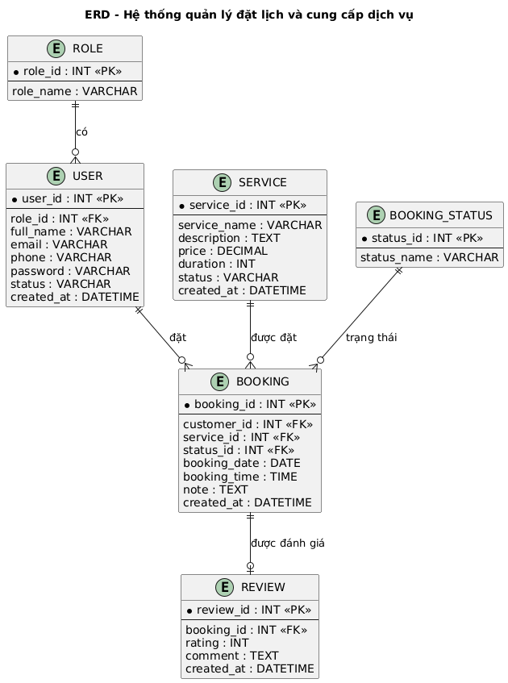

# 3. THIẾT KẾ CƠ SỞ DỮ LIỆU

## 3.1. Mục đích

Thiết kế cơ sở dữ liệu nhằm lưu trữ và quản lý các thông tin phục vụ hoạt động của hệ thống, bao gồm tài khoản, dịch vụ, lịch đặt và đánh giá.

Cơ sở dữ liệu được thiết kế theo hướng hạn chế trùng lặp dữ liệu và đảm bảo tính nhất quán giữa các chức năng.

---

## 3.2. Các thực thể chính

| STT | Thực thể           | Mô tả                              |
| --- | ------------------ | ---------------------------------- |
| 1   | **User**           | Lưu thông tin tài khoản người dùng |
| 2   | **Role**           | Lưu các nhóm quyền trong hệ thống  |
| 3   | **Service**        | Lưu thông tin các dịch vụ          |
| 4   | **Booking**        | Lưu thông tin lịch đặt dịch vụ     |
| 5   | **Review**         | Lưu đánh giá của khách hàng        |
| 6   | **Booking_Status** | Lưu trạng thái của lịch đặt        |

---

## 3.3. Mô tả các thực thể

### 3.3.1. User

Lưu thông tin tài khoản của khách hàng, nhân viên và admin.

Các thuộc tính chính:

* `user_id`: Mã người dùng.
* `role_id`: Mã quyền.
* `full_name`: Họ và tên.
* `email`: Email đăng nhập.
* `password`: Mật khẩu.
* `status`: Trạng thái tài khoản.
* `created_at`: Thời gian tạo tài khoản.

---

### 3.3.2. Role

Xác định quyền truy cập của người dùng.

Các thuộc tính chính:

* `role_id`: Mã quyền.
* `role_name`: Tên quyền.

Các quyền chính:

* Customer
* Staff
* Admin

---

### 3.3.3. Service

Lưu thông tin các dịch vụ mà hệ thống cung cấp.

Các thuộc tính chính:

* `service_id`: Mã dịch vụ.
* `service_name`: Tên dịch vụ.
* `description`: Mô tả dịch vụ.
* `price`: Giá dịch vụ.
* `duration`: Thời lượng thực hiện.
* `status`: Trạng thái dịch vụ.
* `created_at`: Thời gian tạo.

---

### 3.3.4. Booking

Lưu thông tin lịch đặt dịch vụ của khách hàng.

Các thuộc tính chính:

* `booking_id`: Mã lịch đặt.
* `customer_id`: Mã khách hàng.
* `service_id`: Mã dịch vụ.
* `booking_date`: Ngày đặt.
* `booking_time`: Thời gian đặt.
* `note`: Ghi chú.
* `status_id`: Trạng thái lịch.
* `created_at`: Thời gian tạo lịch.

---

### 3.3.5. Review

Lưu đánh giá của khách hàng sau khi sử dụng dịch vụ.

Các thuộc tính chính:

* `review_id`: Mã đánh giá.
* `booking_id`: Mã lịch đặt.
* `customer_id`: Mã khách hàng.
* `rating`: Số điểm đánh giá.
* `comment`: Nội dung nhận xét.
* `created_at`: Thời gian đánh giá.

---

### 3.3.6. Booking_Status

Lưu các trạng thái xử lý của lịch đặt.

Các thuộc tính chính:

* `status_id`: Mã trạng thái.
* `status_name`: Tên trạng thái.

Các trạng thái dự kiến:

* Chờ xác nhận
* Đã xác nhận
* Đang thực hiện
* Hoàn thành
* Đã hủy
* Từ chối

---

## 3.4. Thiết kế sơ đồ ERD

