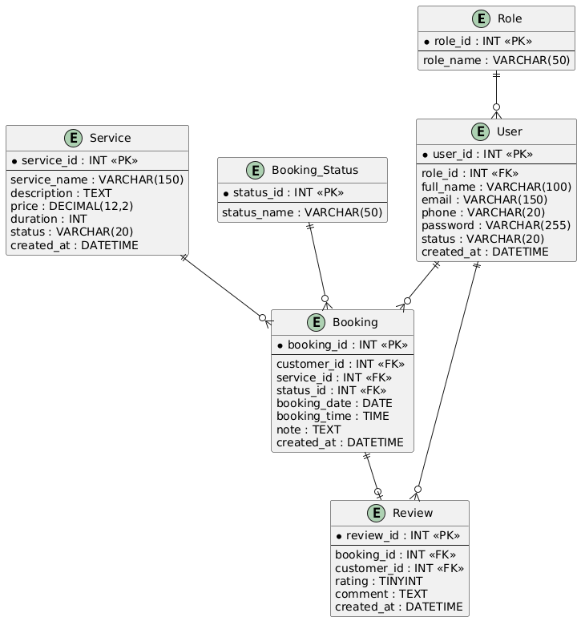

# 4. THIẾT KẾ BẢNG CƠ SỞ DỮ LIỆU

## 4.1. Mục đích

Xác định cấu trúc chi tiết của các bảng trong cơ sở dữ liệu, bao gồm thuộc tính, kiểu dữ liệu, khóa chính, khóa ngoại và các ràng buộc cần thiết.

---

## 4.2. Bảng `Role`

Lưu thông tin các nhóm quyền của người dùng.

| Tên trường  | Kiểu dữ liệu | Ràng buộc          | Mô tả     |
| ----------- | ------------ | ------------------ | --------- |
| `role_id`   | INT          | PK, AUTO_INCREMENT | Mã quyền  |
| `role_name` | VARCHAR(50)  | NOT NULL, UNIQUE   | Tên quyền |

---

## 4.3. Bảng `User`

Lưu thông tin tài khoản của khách hàng, nhân viên và admin.

| Tên trường   | Kiểu dữ liệu | Ràng buộc          | Mô tả                |
| ------------ | ------------ | ------------------ | -------------------- |
| `user_id`    | INT          | PK, AUTO_INCREMENT | Mã người dùng        |
| `role_id`    | INT          | FK, NOT NULL       | Mã quyền             |
| `full_name`  | VARCHAR(100) | NOT NULL           | Họ và tên            |
| `email`      | VARCHAR(150) | NOT NULL, UNIQUE   | Email                |
| `phone`      | VARCHAR(20)  | NULL               | Số điện thoại        |
| `password`   | VARCHAR(255) | NOT NULL           | Mật khẩu đã mã hóa   |
| `status`     | VARCHAR(20)  | NOT NULL           | Trạng thái tài khoản |
| `created_at` | DATETIME     | NOT NULL           | Thời gian tạo        |

---

## 4.4. Bảng `Service`

Lưu thông tin các dịch vụ được cung cấp.

| Tên trường     | Kiểu dữ liệu  | Ràng buộc          | Mô tả                      |
| -------------- | ------------- | ------------------ | -------------------------- |
| `service_id`   | INT           | PK, AUTO_INCREMENT | Mã dịch vụ                 |
| `service_name` | VARCHAR(150)  | NOT NULL           | Tên dịch vụ                |
| `description`  | TEXT          | NULL               | Mô tả dịch vụ              |
| `price`        | DECIMAL(12,2) | NOT NULL           | Giá dịch vụ                |
| `duration`     | INT           | NOT NULL           | Thời lượng, tính bằng phút |
| `status`       | VARCHAR(20)   | NOT NULL           | Trạng thái dịch vụ         |
| `created_at`   | DATETIME      | NOT NULL           | Thời gian tạo              |

---

## 4.5. Bảng `Booking_Status`

Lưu danh sách trạng thái của lịch đặt.

| Tên trường    | Kiểu dữ liệu | Ràng buộc          | Mô tả          |
| ------------- | ------------ | ------------------ | -------------- |
| `status_id`   | INT          | PK, AUTO_INCREMENT | Mã trạng thái  |
| `status_name` | VARCHAR(50)  | NOT NULL, UNIQUE   | Tên trạng thái |

---

## 4.6. Bảng `Booking`

Lưu thông tin lịch đặt dịch vụ của khách hàng.

| Tên trường     | Kiểu dữ liệu | Ràng buộc          | Mô tả           |
| -------------- | ------------ | ------------------ | --------------- |
| `booking_id`   | INT          | PK, AUTO_INCREMENT | Mã lịch đặt     |
| `customer_id`  | INT          | FK, NOT NULL       | Mã khách hàng   |
| `service_id`   | INT          | FK, NOT NULL       | Mã dịch vụ      |
| `booking_date` | DATE         | NOT NULL           | Ngày đặt        |
| `booking_time` | TIME         | NOT NULL           | Thời gian đặt   |
| `note`         | TEXT         | NULL               | Ghi chú         |
| `status_id`    | INT          | FK, NOT NULL       | Trạng thái lịch |
| `created_at`   | DATETIME     | NOT NULL           | Thời gian tạo   |

---

## 4.7. Bảng `Review`

Lưu đánh giá của khách hàng sau khi sử dụng dịch vụ.

| Tên trường    | Kiểu dữ liệu | Ràng buộc            | Mô tả              |
| ------------- | ------------ | -------------------- | ------------------ |
| `review_id`   | INT          | PK, AUTO_INCREMENT   | Mã đánh giá        |
| `booking_id`  | INT          | FK, UNIQUE, NOT NULL | Mã lịch đặt        |
| `customer_id` | INT          | FK, NOT NULL         | Mã khách hàng      |
| `rating`      | TINYINT      | NOT NULL             | Điểm đánh giá      |
| `comment`     | TEXT         | NULL                 | Nội dung đánh giá  |
| `created_at`  | DATETIME     | NOT NULL             | Thời gian đánh giá |

---

## 4.8. Tổng hợp các bảng

| STT | Bảng             | Khóa chính   | Chức năng               |
| --- | ---------------- | ------------ | ----------------------- |
| 1   | `Role`           | `role_id`    | Quản lý nhóm quyền      |
| 2   | `User`           | `user_id`    | Quản lý tài khoản       |
| 3   | `Service`        | `service_id` | Quản lý dịch vụ         |
| 4   | `Booking_Status` | `status_id`  | Quản lý trạng thái lịch |
| 5   | `Booking`        | `booking_id` | Quản lý lịch đặt        |
| 6   | `Review`         | `review_id`  | Quản lý đánh giá        |

---

## 4.9. Sơ đồ liên kết bảng

