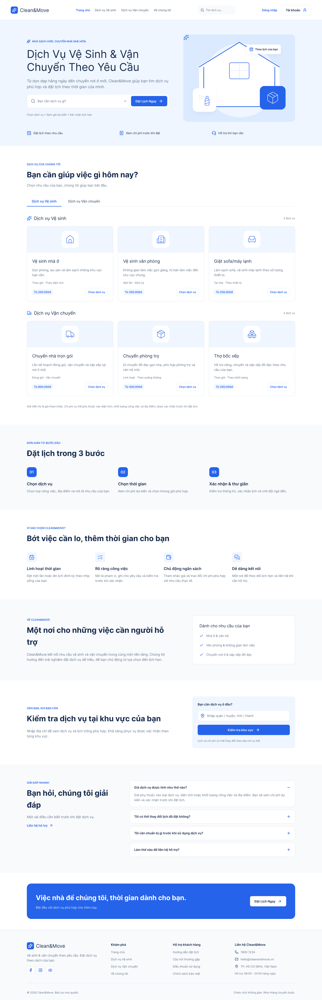
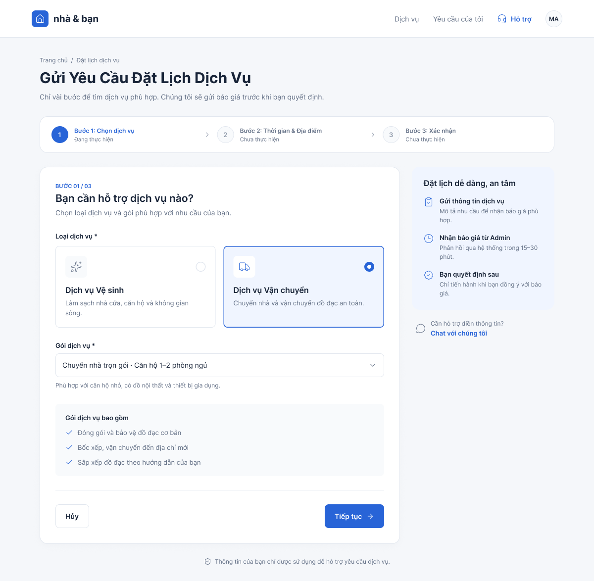
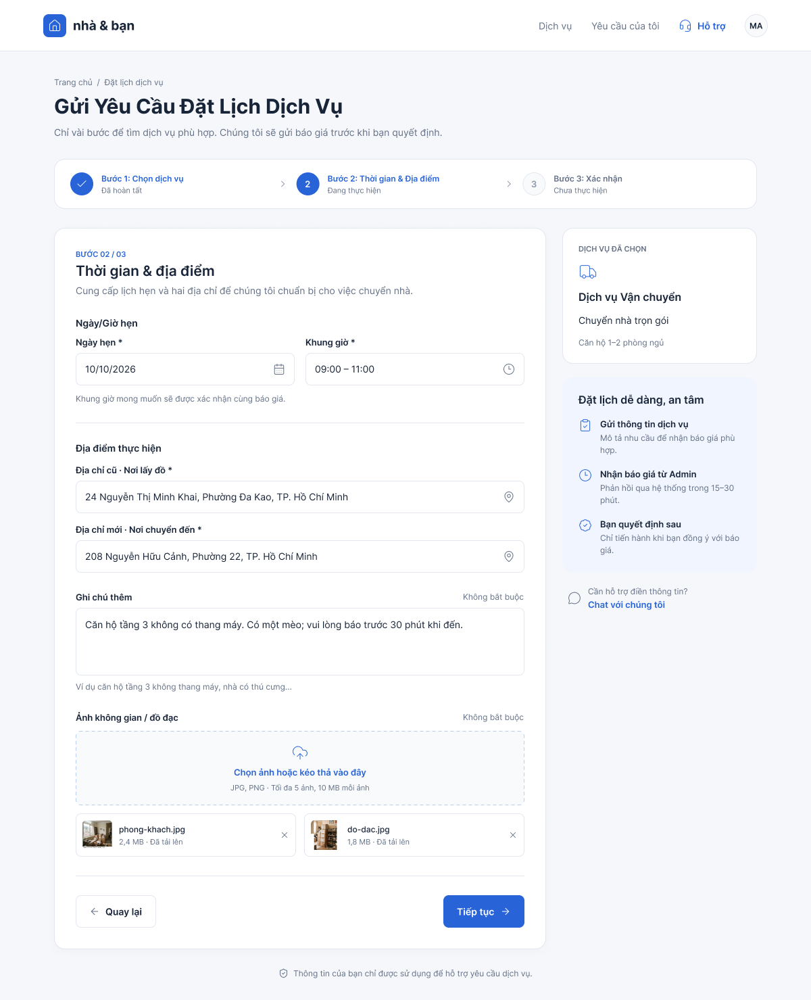
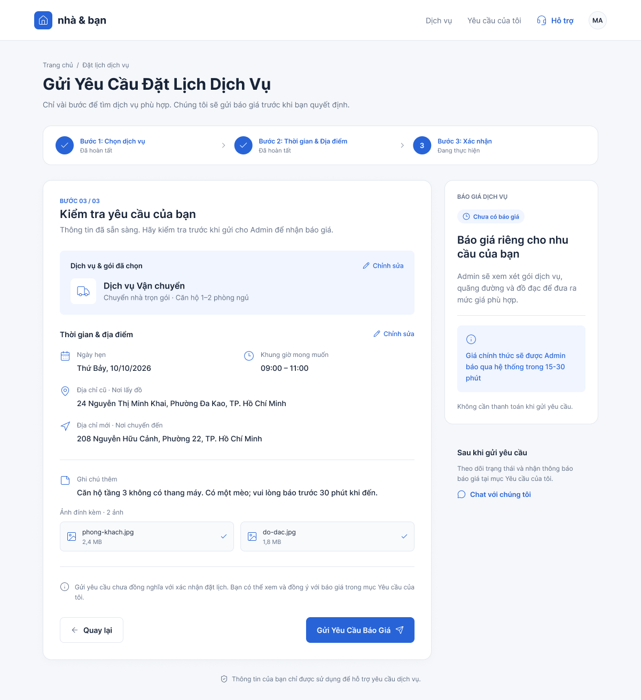
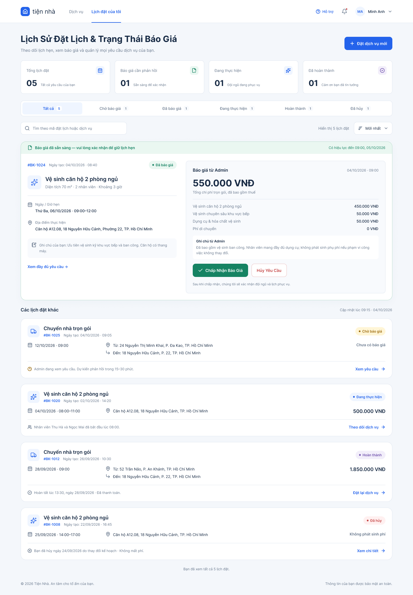
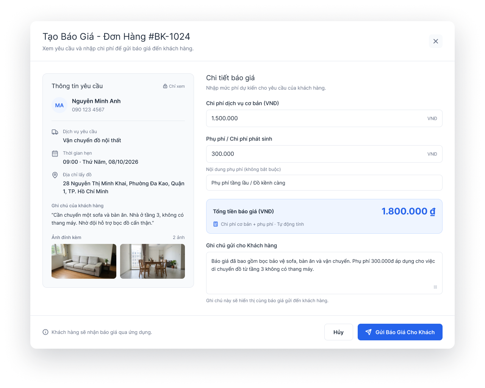
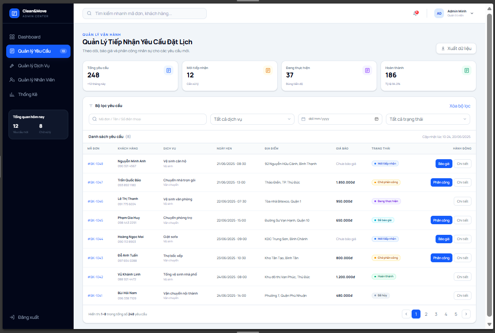
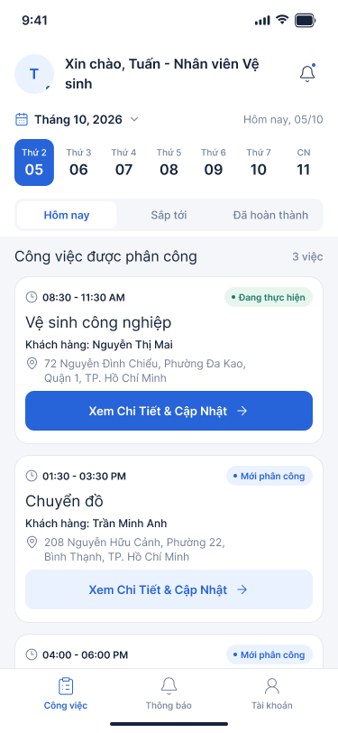
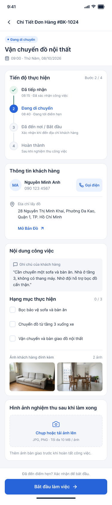

# 5. THIẾT KẾ GIAO DIỆN

## 5.1. Mục đích

Thiết kế giao diện nhằm mô tả các màn hình chính của hệ thống, giúp hình dung bố cục, chức năng và luồng thao tác của người dùng trước khi triển khai lập trình.

## 5.2. Giao diện hệ thống

### 5.2.1. Trang chủ

### 5.2.2. Chọn dịch vụ

### 5.2.3. Thời gian và địa điểm

### 5.2.4. Xác nhận yêu cầu

### 5.2.5. Lịch sử đặt lịch

### 5.2.6. Tạo báo giá

### 5.2.7. Tiếp nhận yêu cầu

### 5.2.8. Danh sách công việc được phân công

### 5.2.9. Chi tiết và cập nhật trạng thái

