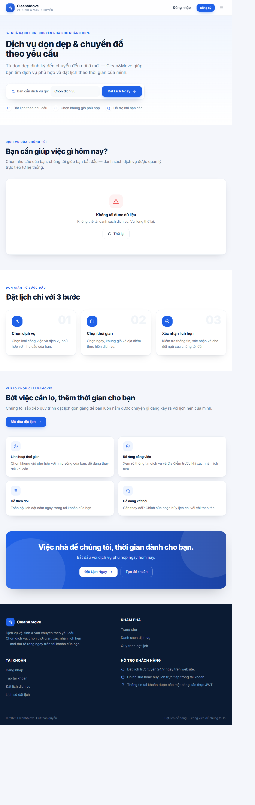
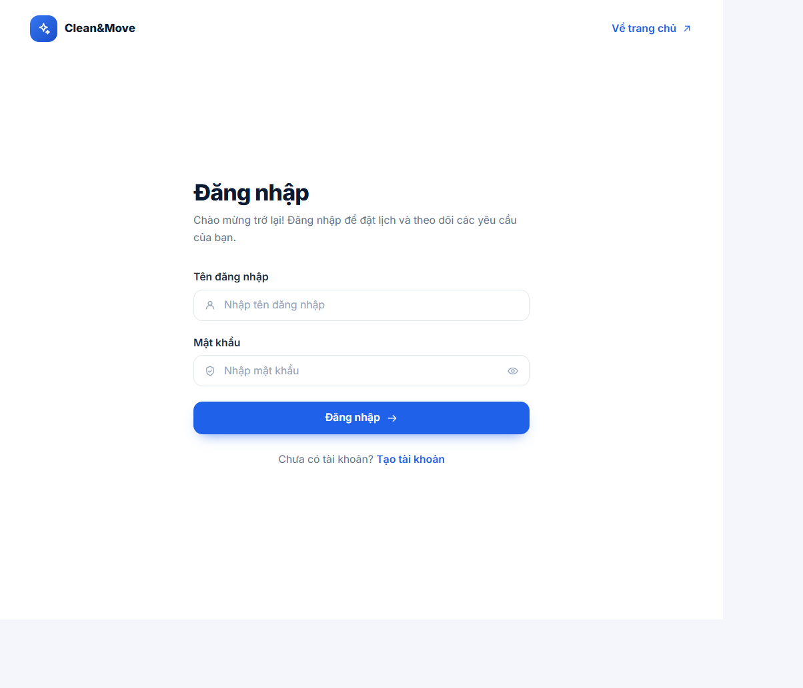
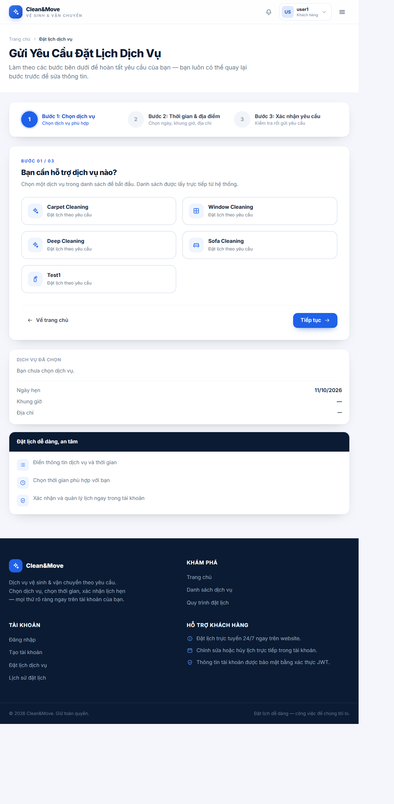
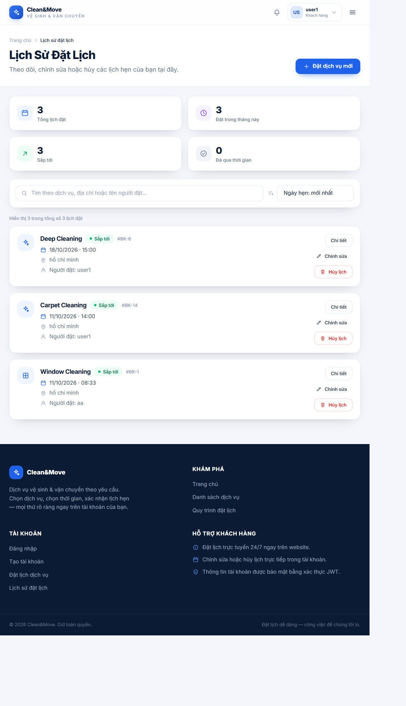
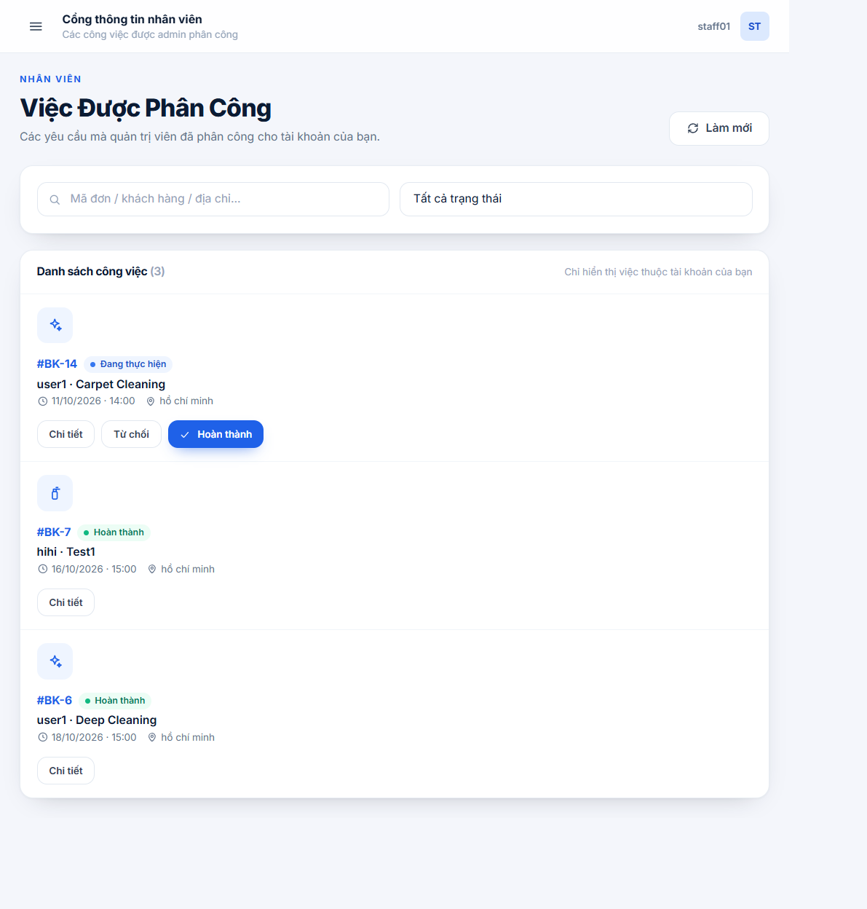
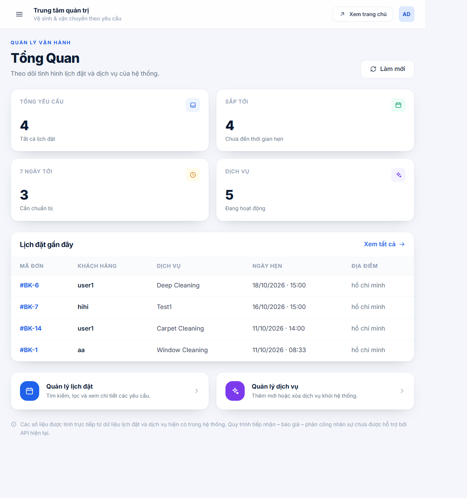

# 4. HOÀN THIỆN GIAO DIỆN FRONTEND

## 4.1. Mục tiêu

Hoàn thiện giao diện người dùng của hệ thống CleanMove dựa trên các yêu cầu chức năng, quy trình nghiệp vụ và thiết kế giao diện đã xây dựng trong tuần 2.

Giao diện cần bảo đảm tính nhất quán về bố cục, màu sắc, thành phần hiển thị và cách thức tương tác, đồng thời hỗ trợ người dùng thực hiện các nghiệp vụ chính như xem dịch vụ, đặt lịch, theo dõi yêu cầu và quản lý công việc.

Các mục tiêu chính bao gồm:

- Hoàn thiện các màn hình theo thiết kế đã thống nhất.
- Tổ chức các thành phần giao diện có khả năng tái sử dụng.
- Hiển thị dữ liệu và thông báo phù hợp với trạng thái xử lý.
- Chuẩn bị giao diện để tích hợp với Backend thông qua API.
- Kiểm tra khả năng sử dụng trên các kích thước màn hình khác nhau.

## 4.2. Công nghệ sử dụng

| Công nghệ | Vai trò |
|---|---|
| React | Xây dựng giao diện theo mô hình component |
| TypeScript hoặc JavaScript | Xử lý logic giao diện, tùy cấu hình dự án |
| HTML và CSS | Xây dựng cấu trúc và trình bày giao diện |
| Tailwind CSS hoặc CSS theo dự án | Quản lý kiểu dáng giao diện |
| REST API | Trao đổi dữ liệu với Backend |

## 4.3. Nguyên tắc thiết kế giao diện

Trong quá trình hoàn thiện giao diện, hệ thống hướng đến các nguyên tắc sau:

- **Tính nhất quán:** Các trang sử dụng chung phong cách thiết kế, màu sắc và quy tắc trình bày.
- **Tính dễ sử dụng:** Các chức năng chính được bố trí rõ ràng, hạn chế thao tác không cần thiết.
- **Khả năng phản hồi:** Giao diện hiển thị trạng thái tải dữ liệu, kết quả xử lý và thông báo lỗi.
- **Khả năng tái sử dụng:** Các thành phần như nút, trường nhập liệu, thẻ dịch vụ và thanh điều hướng được tổ chức thành các component phù hợp.
- **Khả năng thích ứng:** Bố cục được kiểm tra trên các kích thước màn hình khác nhau.

## 4.4. Các giao diện chính

### 4.4.1. Giao diện trang chủ

Trang chủ giới thiệu dịch vụ vệ sinh của CleanMove và cung cấp các lối truy cập đến những chức năng chính của hệ thống.

Các thành phần có thể bao gồm thanh điều hướng, khu vực giới thiệu, danh sách dịch vụ nổi bật và nút bắt đầu đặt lịch.

### 4.4.2. Giao diện đăng nhập và đăng ký

Giao diện xác thực hỗ trợ người dùng nhập thông tin tài khoản để đăng nhập hoặc tạo tài khoản mới.

Cần kiểm tra dữ liệu đầu vào, thông báo khi thông tin không hợp lệ và cách xử lý kết quả phản hồi từ Backend.

### 4.4.3. Giao diện lựa chọn dịch vụ

Giao diện cho phép khách hàng xem thông tin dịch vụ và lựa chọn dịch vụ phù hợp với nhu cầu vệ sinh.

Thông tin hiển thị cần thống nhất với dữ liệu dịch vụ được cung cấp từ Backend hoặc nguồn dữ liệu mà dự án đang sử dụng.

### 4.4.4. Giao diện đặt lịch

Quy trình đặt lịch được tổ chức thành các bước nhằm giúp khách hàng cung cấp thông tin theo trình tự.

Các bước nghiệp vụ chính gồm:

1. Lựa chọn dịch vụ.
2. Chọn thời gian và địa điểm thực hiện.
3. Nhập thông tin cần thiết và xác nhận yêu cầu.
4. Gửi yêu cầu đặt lịch và hiển thị kết quả xử lý.

Dữ liệu gửi đi cần đáp ứng định dạng và các trường bắt buộc theo API Backend.

### 4.4.5. Giao diện lịch sử đặt lịch

Giao diện lịch sử đặt lịch giúp khách hàng theo dõi các yêu cầu đã gửi, xem thông tin đặt lịch và trạng thái xử lý.

Các thao tác như xem chi tiết hoặc hủy yêu cầu chỉ được cung cấp khi đáp ứng các điều kiện nghiệp vụ của hệ thống.

### 4.4.6. Giao diện nhân viên

Giao diện nhân viên hỗ trợ theo dõi công việc được phân công, tiếp nhận công việc và cập nhật tiến độ thực hiện.

Các nút thao tác cần phản ánh đúng trạng thái hiện tại của công việc. Ví dụ, nhân viên chỉ được bắt đầu thực hiện sau khi đã tiếp nhận công việc nếu đó là quy tắc được áp dụng trong Backend.

### 4.4.7. Giao diện quản trị viên

Giao diện quản trị viên cung cấp các chức năng quản lý dữ liệu và theo dõi hoạt động hệ thống theo quyền được cấp.

Các chức năng cụ thể cần được đối chiếu với phạm vi nghiệp vụ và các API thực tế của dự án.

## 4.5. Tổ chức các thành phần giao diện

Giao diện được tổ chức theo các component nhằm giảm trùng lặp mã nguồn và thuận tiện cho việc bảo trì.

Các nhóm component có thể bao gồm:

- Thanh điều hướng và bố cục trang.
- Biểu mẫu nhập dữ liệu.
- Thẻ hiển thị dịch vụ.
- Thành phần chọn thời gian và địa điểm.
- Bảng hoặc danh sách đặt lịch.
- Nhãn trạng thái và thông báo kết quả.
- Các nút thao tác theo vai trò người dùng.

## 4.6. Tích hợp giao diện với Backend

Khi tích hợp Frontend và Backend, cần kiểm tra các nội dung sau:

- URL và phương thức HTTP của API.
- Cấu trúc dữ liệu gửi đi và nhận về.
- Cơ chế gửi thông tin xác thực khi cần thiết.
- Cách hiển thị trạng thái tải dữ liệu.
- Cách thông báo thành công hoặc thất bại.
- Cách xử lý lỗi kết nối và lỗi nghiệp vụ.
- Việc cập nhật giao diện sau khi dữ liệu thay đổi.

## 4.7. Kiểm tra giao diện

Quá trình kiểm tra tập trung vào các nội dung:

- Bố cục và nội dung hiển thị.
- Tính hợp lệ của dữ liệu biểu mẫu.
- Khả năng điều hướng giữa các màn hình.
- Trạng thái hiển thị sau khi gửi yêu cầu.
- Khả năng xử lý dữ liệu rỗng hoặc lỗi API.
- Quyền hiển thị và thực hiện thao tác theo vai trò.
- Khả năng hiển thị trên máy tính và điện thoại.

## 4.8. Hình ảnh minh họa

Các hình ảnh dự kiến bao gồm:

- Giao diện trang chủ.

- Giao diện đăng nhập.

- Giao diện đặt lịch.

- Giao diện lịch sử đặt lịch.

- Giao diện nhân viên.

- Giao diện quản trị viên.

